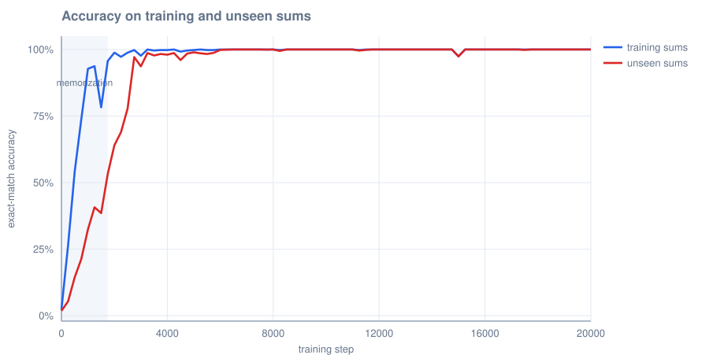
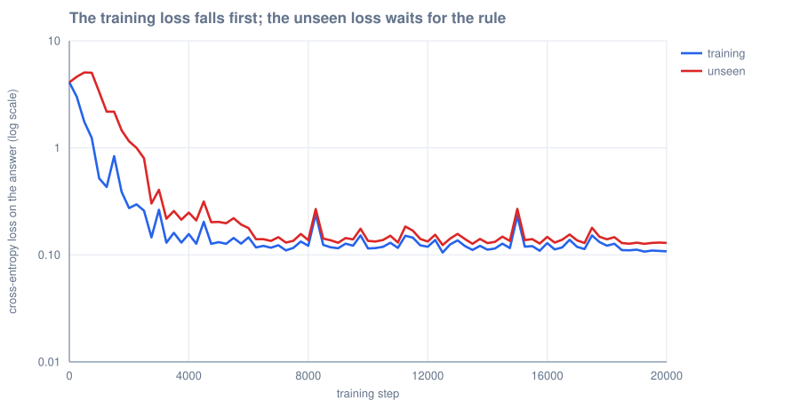

# Grokking in a tiny transformer

This repository is the companion code for the article
**[Grokking: the jump from memory to rule](https://jacano.github.io/blog/grokking-from-memory-to-rule/)**.

It trains a small transformer on one arithmetic task and shows the moment when the
model stops memorizing and starts generalizing. The experiment is two C# files: the
task, the model, the training loop and the figures. TorchSharp carries the automatic
differentiation, so the model is one class and the training loop is a handful of lines.

| Property | Value |
| --- | ---: |
| runtime | .NET 11 |
| dependencies | TorchSharp + libtorch |
| a full run | **about 90 seconds** |
| result | **100% of the 1,966 unseen pairs** |

## The library

**[TorchSharp](https://github.com/dotnet/TorchSharp)** 0.107, the .NET binding of
PyTorch, with the native build of libtorch 2.10 as the NuGet package
`libtorch-cpu`. There is no C++ compiler in the loop: the native library arrives as a
package.

It is the only serious candidate in .NET for this. `Microsoft.ML.TorchSharp` is a
wrapper for specific NLP scenarios and does not expose a general layer API;
`TensorFlow.NET` is a Keras-like binding with a heavier and less predictable native
dependency; and ML.NET has no autograd for a network you define yourself.

## The model, in full

This is the whole architecture. There is no other file that describes it.

```csharp
public override Tensor forward(Tensor index)
{
    long batch = index.shape[0];
    long length = index.shape[1];
    Tensor x = _wte.forward(index);                             // [B, T, C]

    // --- attention: the framework knows how to do this, and how to mask it ---
    Tensor h = RmsNorm(x);
    Tensor q = _wq.forward(h).reshape(batch, length, _heads, _headDim).transpose(1, 2);
    Tensor k = _wk.forward(h).reshape(batch, length, _heads, _headDim).transpose(1, 2);
    Tensor v = _wv.forward(h).reshape(batch, length, _heads, _headDim).transpose(1, 2);
    Tensor attended = scaled_dot_product_attention(q, k, v, is_casual: true);
    x = x + _wo.forward(attended.transpose(1, 2).reshape(batch, length, _embd));

    // --- MLP: project up, run the non-linearity, project back ---
    x = x + _fc2.forward(relu(_fc1.forward(RmsNorm(x))));
    return _lmHead.forward(x); // [B, T, vocab]
}
```

There is no positional embedding. The token already says which operand it is (`a`
comes before `+`, `b` comes after it), and addition is symmetric, so a second table
that tells the two slots apart adds parameters and nothing else.

The three lines that replace the whole backward pass:

```csharp
Tensor loss = lossFn.forward(logits.reshape(-1, Vocab), targets.reshape(-1));
loss.backward();
optimiser.step();
```

And the two that replace the optimizer:

```csharp
using var optimiser = optim.Adam(model.parameters(), lr: lr, beta1: 0.85, beta2: 0.99, weight_decay: wd);
```

## The result



| step | train acc | unseen acc | parameter size |
| ---: | ---: | ---: | ---: |
| 0 | 2.3% | 1.8% | 18.9 |
| 1,000 | 92.8% | 32.4% | 11.0 |
| 2,000 | 98.8% | 64.0% | 10.7 |
| 3,000 | 97.7% | 93.7% | 10.1 |
| 4,000 | 99.8% | 98.1% | 9.7 |
| 5,000 | 99.8% | 98.9% | 9.6 |
| 7,500 | 100% | 100% | 9.5 |
| 20,000 | 100% | **100%** | 9.3 |

The model memorizes the train set by step 1,000, and the unseen accuracy then climbs
for another 2,000 steps. At the end it answers **all 1,966 pairs it never saw**.




The figure carries two axes, one per curve. The blue line is the size of the
parameters on the left axis. The red line is the accuracy on unseen pairs on the
right axis. The size falls at once, because the decay charges for every parameter
from the first step; it climbs while the model stores 843 answers, and it falls
again as the rule takes over.

## The control

Set the decay to zero and the run never gets there. The same program, with `--wd 0`:

| step | decay | train acc | unseen acc | size |
| ---: | :--- | ---: | ---: | ---: |
| 2,000 | with | 98.8% | 64.0% | 10.7 |
| 2,000 | without | 100% | 30.6% | 36.2 |
| 4,000 | with | 99.8% | 98.1% | 9.7 |
| 4,000 | without | 100% | 30.6% | 41.0 |
| 12,000 | with | 100% | 100% | 9.4 |
| 12,000 | without | 100% | 30.8% | 53.0 |
| 20,000 | without | 100% | **30.9%** | 61.2 |

Without the decay the model memorizes every training pair and answers 30.9% of the
unseen ones. More steps do not change it: the accuracy stays at 30.6–30.9% from step
2,000, and the size of the parameters climbs to 61 because nothing in the run charges
for it.

```bash
dotnet run -c Release -- --wd 0
```

## Reproduce it

You need the .NET SDK 11 or newer. The first build downloads libtorch, which is a
few hundred megabytes.

```bash
git clone https://github.com/jacano/grokking-torchsharp
cd grokking-torchsharp
make run
```

`make` on its own compiles and runs the style check; it does not train. `make` does not
ship with Windows, and every target has a `dotnet` form for that case: `dotnet run -c
Release` where the target says `make run`.

The run takes about 90 seconds and writes three things:

| Where | What |
| --- | --- |
| `data/train.txt`, `data/test.txt` | the two splits, one pair per line: 843 lines and 1,966 lines |
| `runs/grokking.csv` | the logged numbers of every step |
| `figures/` | the figures in this article |

Each row of `runs/grokking.csv` has six columns:

| Column | Meaning |
| --- | --- |
| `step` | training step |
| `train_loss` | cross-entropy on the answer over 512 training pairs |
| `train_acc` | exact match on those pairs |
| `test_loss` | cross-entropy on the answer over all 1,966 unseen pairs |
| `test_acc` | exact match on the unseen pairs |
| `param_norm` | L2 norm of all 56,320 parameters: the square root of the sum of their squares |

The repository has a `Makefile` with one target per action. `make help` lists them,
and the two worth knowing here are:

| command | what it does |
| --- | --- |
| `make control` | the same run with the decay at zero, which never learns the rule |
| `make run ARGS="--p 13 --steps 3000"` | another modulus, or another number of steps |

The defaults are `lr = 0.003`, `wd = 0.005`, 20,000 steps, and the last 2,000 steps
take the learning rate to zero (`--anneal 2000`), so the run settles instead of ending
on an oscillation. A slower seed needs more steps: the same model reaches 100% with
`--steps 44000 --anneal 4000`.

## Inference

`model.pt` is **not** part of the repository. `make save` writes it at the end of a run
and `make infer` reads it back. This is one line in each direction, because a framework
keeps the whole state dictionary for you:

```bash
make save                      # train, then write model.pt
make infer PAIR=12+35
```

```
inference 12+35 = 47  [ok]  top: 47 (89%), 21 (2%), 52 (2%)
inference 7+44 = 51  [ok]  top: 51 (90%), 20 (3%), 50 (1%)
inference 50+50 = 47  [ok]  top: 47 (86%), 52 (4%), 29 (2%)
inference 0+13 = 13  [ok]  top: 13 (90%), 36 (2%), 8 (1%)
```

All four are unseen pairs.

## What the model is thinking

A model does not answer a question, it spreads a chance over the options. `make explain
PAIR=12+35` writes the 53 probabilities the saved model gives to one sum
(`runs/probabilities.csv`) and draws them (`figures/grokking-probabilities.svg`).

| the saved model | chance it gives to the right answer, 47 |
| --- | ---: |
| after 1,000 steps, when it has memorized | 26.7% |
| after 20,000 steps, when it has the rule | **89.4%** |

`make explain NOTE="after 1,000 steps"` puts your own words in the title, which is how
the two rows above were drawn.

## What the framework does not do

The framework removes the arithmetic, not the decisions. You still choose the
architecture, the split, the number of steps, the learning rate and the weight
decay, and the run still has to be tuned. Three of the things this repository had to
get right:

- **The initialisation.** A framework starts an embedding at `N(0, 1)` and a linear
  layer in a uniform range. The article uses microgpt's `N(0, 0.08)`, so this file
  sets it in four lines. Measured by the size of the parameters, the run then starts at 18.9 instead of 69.6.
- **The decay is not the same decay.** `AdamW` subtracts the decay from the weight
  outside the update, and `Adam` adds it to the gradient, as microgpt does. With
  `AdamW` this run never jumped, at any decay from 0.002 to 0.5; the parameter norm
  settled at 40 to 50 and the model stayed on the memorizing answer. With `Adam` and the decay inside the gradient, **`wd = 0.005` works**, and the norm settles at 9.3. Two names for the same word, two different
  runs.
- **The schedule.** The run reaches 100% and then oscillates around it. The last
  2,000 steps take the learning rate to zero, so it ends on the solution instead of
  on a dip.

The framework also brings its own random numbers, so the seed decides the initial
weights and the split of the pairs. Change the seed and you get a different run of
the same experiment: the jump moves, and the rule arrives just the same. The run in
this repository is seed 42.
